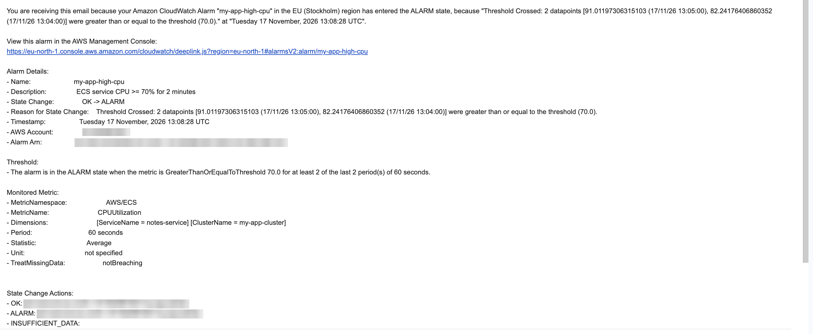

# Алерти на пошту (CloudWatch → SNS → email)

Конфігурація: [terraform/cloudwatch.tf](../terraform/cloudwatch.tf). Тема SNS `notes-api-alerts`, підписка email на `var.budget_email`, яку треба підтвердити за посиланням з першого листа AWS.

## Умова

| Аларм | Метрика | Умова | Дії |
|---|---|---|---|
| `notes-api-high-cpu` | `AWS/ECS CPUUtilization`, Average по сервісу | **≥ 70 % у 2 послідовних хвилинних періодах** | `ALARM` і `OK` → SNS |
| `notes-api-high-latency` | `AWS/ApplicationELB TargetResponseTime`, p95 | ≥ 500 мс у 2 послідовних хвилинних періодах | `ALARM` і `OK` → SNS |

`treat_missing_data = notBreaching`: відсутність даних (наприклад, коли трафіку немає) не вважається проблемою і не будить уночі.

### Обґрунтування

- **70 % — вище порогу автомасштабування (60 %).** Штатний scale-out листа не викликає. Лист означає, що автомасштабування не впоралося: досягнуто `max_capacity = 4`, нові задачі не стартують або навантаження росте швидше, ніж додаються задачі. Тільки в цьому випадку потрібна людина.
- **2 періоди по 1 хв, а не 1.** Одиночний пік CPU (GC, деплой, прогрів) не надсилає лист. Сталої проблеми двохвилинна затримка не приховує.
- **Не більше 2 періодів.** При 5 періодах реакція на справжню проблему розтягнулася б до 6–7 хв.
- **Латентність p95 ≥ 500 мс** — це симптом, який бачить користувач. CPU — лише причина, і вона буває не єдиною (повільна БД, Redis, мережа). Тому другий аларм ловить деградацію навіть за нормального CPU.
- **`ok_actions`** — другий лист приходить, коли метрика повернулася в норму. Так видно, скільки тривав інцидент, і не треба вручну перевіряти, чи все минуло.

## Знімки листів

### Лист 1 — ALERT

### Лист 2 — OK

## Час реакції

| Подія | Час |
|---|---|
| Початок сталого навантаження (Locust вийшов на повну кількість користувачів) | **(15:01)**  |
| Аларм перейшов у `ALARM` | **15:08:28** |
| Отримано перший лист  | **15:08:30** |
| **Від початку навантаження до першого листа** | **~7 хв** |
| Навантаження знято | **15:10:28** |
| Отримано лист `OK` | **15:10** |

## Чи прийнятний такий час реакції для реального сервісу

**Для навчального або внутрішнього сервісу — так.** Для сервісу з реальними користувачами — **ні, у такому вигляді не прийнятний**:
- **7 хв — це лише виявлення.** Далі людина має побачити лист, відкрити ноутбук і розібратися. Реальний час до початку дій з поштою вимірюється десятками хвилин, а вночі — годинами. Пошта не будить.
- **CPU — це причина, а не симптом.** Користувачам байдуже до CPU, їм важливі помилки й латентність. Сервіс може віддавати 5xx при CPU 20 % (впала БД), і цей аларм промовчить.

Як покращити:

1. Алертити за **симптомами**: частка 5xx і p95/p99 латентності.
3. Критичні алерти надсилати в PagerDuty / Opsgenie / дзвінок або SMS через SNS. Пошта годиться лише для некритичних сповіщень.
4. Додати аларм на `HealthyHostCount < 1` і на DLQ (`ApproximateNumberOfMessagesVisible > 0`). Це миттєві сигнали про реальну відмову.
