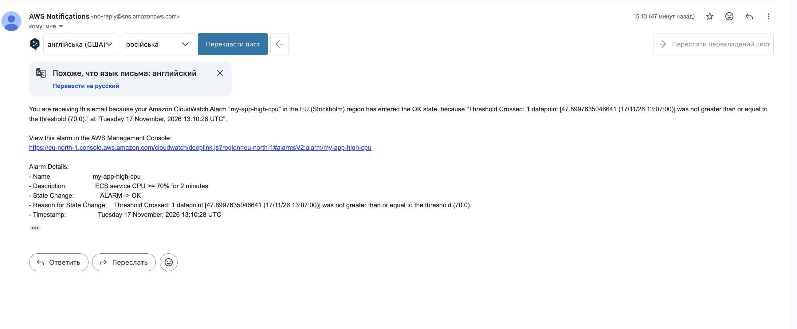

# Алерти на пошту (CloudWatch → SNS → email)

Конфігурація: [terraform/cloudwatch.tf](../terraform/cloudwatch.tf). Тема SNS `notes-alerts`, підписка email на `var.budget_email`, яку треба підтвердити за посиланням з першого листа AWS.

## Умова

| Аларм | Метрика | Умова | Дії |
|---|---|---|---|
| `notes-high-cpu` | `AWS/ECS CPUUtilization`, Average по сервісу | **≥ 70 % у 2 послідовних хвилинних періодах** | `ALARM` і `OK` → SNS |
| `notes-high-latency` | `AWS/ApplicationELB TargetResponseTime`, p95 | ≥ 500 мс у 2 послідовних хвилинних періодах | `ALARM` і `OK` → SNS |

Окремо в [terraform/worker.tf](../terraform/worker.tf) є аларм `notes-dlq-not-empty` (у DLQ ≥ 1 повідомлення → SNS, той самий email): він сигналізує, що запис остаточно не вдався.

`treat_missing_data = notBreaching`: відсутність даних (наприклад, коли трафіку немає) не вважається проблемою і не будить уночі.

### Обґрунтування

- **70 % — вище порогу автомасштабування (60 %).** Задумка: плавне зростання закривається scale-out ще до 70 %, і лист означає, що автомасштабування не встигає (досягнуто `max_capacity = 4`, задачі не стартують або навантаження росте швидше, ніж додаються задачі). У нашому прогоні навантаження зросло різко (CPU одразу 82–91 %), тому лист прийшов і під час штатного scale-out: нові задачі з'явилися лише через ~3 хв після перетину порогу.
- **2 періоди по 1 хв, а не 1.** Одиночний пік CPU (GC, деплой, прогрів) не надсилає лист. Сталої проблеми двохвилинна затримка не приховує.
- **Не більше 2 періодів.** При 5 періодах реакція на справжню проблему розтягнулася б до 6–7 хв.
- **Латентність p95 ≥ 500 мс** — це симптом, який бачить користувач. CPU — лише причина, і вона буває не єдиною (повільна БД, Redis, мережа). Тому другий аларм ловить деградацію навіть за нормального CPU.
- **`ok_actions`** — другий лист приходить, коли метрика повернулася в норму. Так видно, скільки тривав інцидент, і не треба вручну перевіряти, чи все минуло.

## Знімки листів

### Лист 1 — ALERT

### Лист 2 — OK

## Час реакції

Прогін 17.11, час місцевий (UTC+2); точки й мітки часу — з тексту листів.

| Подія | Час |
|---|---|
| Початок сталого навантаження (Locust вийшов на 200 користувачів) | **~15:01** |
| Перша хвилинна точка CPU ≥ 70 % (82.2 %) | 15:04 |
| Друга точка ≥ 70 % (91.0 %) — умова «2 хв» виконана | 15:05 (період закрився о 15:06) |
| Аларм перейшов у `ALARM`, отримано перший лист | **15:08:28** |
| **Від початку сталого навантаження до першого листа** | **≈ 7.5 хв** (з них ≈ 2.5 хв — затримка доставки метрики й оцінки аларму після закриття другого періоду) |
| Точка 15:07 = 47.9 % → аларм у `OK`, отримано другий лист | **15:10:28** |

**Чому `OK` прийшов ще під навантаженням.** Навантаження знято близько 15:13, а лист `OK` прийшов о 15:10. Причина в автомасштабуванні: о ~15:05 сервіс виріс з 2 до 4 задач, середній CPU впав до ~48 %, і аларм повернувся в норму. Тобто другий лист означає «перевантаження усунуто» (масштабуванням), а не «тест закінчився».

## Чи прийнятний такий час реакції для реального сервісу

**Для навчального або внутрішнього сервісу — так.** Для сервісу з реальними користувачами — **ні, у такому вигляді не прийнятний**:
- **7 хв — це лише виявлення.** Далі людина має побачити лист, відкрити ноутбук і розібратися. Реальний час до початку дій з поштою вимірюється десятками хвилин, а вночі — годинами. Пошта не будить.
- **CPU — це причина, а не симптом.** Користувачам байдуже до CPU, їм важливі помилки й латентність. Сервіс може віддавати 5xx при CPU 20 % (впала БД), і цей аларм промовчить.

Як покращити:

1. Алертити за **симптомами**: частка 5xx і p95/p99 латентності.
2. Критичні алерти надсилати в PagerDuty / Opsgenie / дзвінок або SMS через SNS. Пошта годиться лише для некритичних сповіщень.
3. Додати аларм на `HealthyHostCount < 1` (ALB без жодного здорового таргета). Це миттєвий сигнал про реальну відмову, як і вже наявний `notes-dlq-not-empty` для черги.
