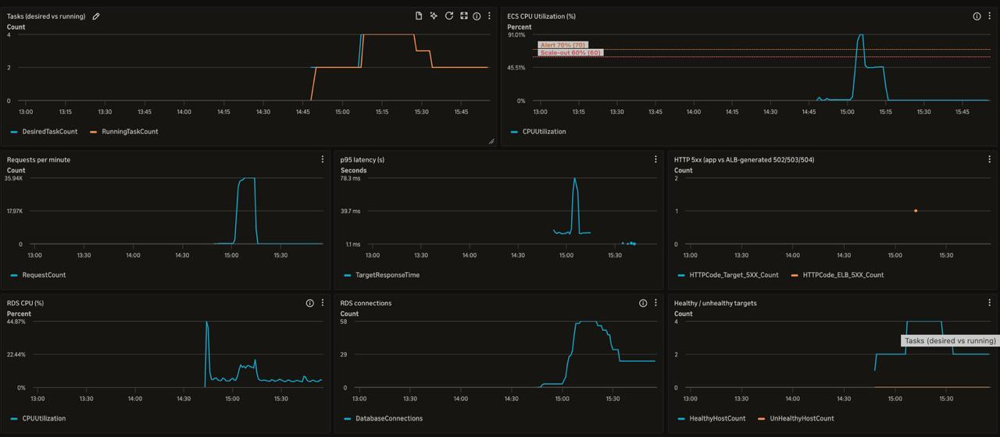

# Автомасштабування API (ECS Fargate)
## Обрані параметри

| Параметр | Значення | Обґрунтування |
|---|---|---|
| Метрика | `AWS/ECS CPUUtilization`, Average по сервісу `notes-service` | Застосунок — синхронний FastAPI в одному процесі uvicorn на 0.5 vCPU; при рості RPS першим насичується саме CPU (серіалізація JSON, SQLAlchemy). Пам'ять (1 GB) за навантаження майже не змінюється, тому для масштабування не годиться. |
| **Цільове значення / поріг scale-out** | **CPU ≥ 60 %** за 1 хв | Вище ~75–80 % p95 різко зростає, тож такий поріг означав би, що масштабуємося вже після того, як користувачі відчули сповільнення. Нижчий поріг  тримав би половину оплаченого CPU постійно вільною і масштабувався б на кожен дрібний сплеск.|
| Кроки scale-out | 60–80 % → +1 задача; ≥ 80 % → +2 задачі | Різкий сплеск закривається за один крок, а не за два цикли по cooldown. |
| Поріг scale-in | CPU < 30 % протягом 10 хв поспіль → −1 задача | Широкий проміжок між 30 % і 60 % (гістерезис) не дає сервісу «смикатися». 10 хв — щоб короткий спад між хвилями навантаження не прибирав задачі. |
| `min_capacity` | 2 (вдень), 1 (вночі — scheduled action) | 2 задачі — по одній у кожній з двох AZ, переживаємо падіння задачі/зони. Вночі трафіку майже немає, тому мінімум знижено (див. SCHEDULE.md). |
| `max_capacity` | 4 | Межа бюджету та БД: кожна задача тримає пул до 15 з'єднань (`pool_size=10 + max_overflow=5`), 4 × 15 = 60. Ще є воркери, а `db.t3.micro` допускає лише ~100 з'єднань. |
| Cooldown scale-out | 60 с | Приблизно стільки нова задача стартує, тягне образ і проходить health check ALB (interval 5 с × 2) з `health_check_grace_period = 60 с`. |
| Cooldown scale-in | 300 с | Знімаємо задачі обережно, по одній, і даємо метриці стабілізуватися після кожного кроку. |

## Чому масштабування відбувається із запізненням

На графіку видно дві асиметрії: між перетином порогу 60 % і появою нових задач минає кілька хвилин, а після падіння навантаження задачі прибираються лише через ~15–20 хв. Обидві закладені в конфігурацію навмисно.

### Від перетину порогу до нової задачі (≈ 3–4 хв)

Сигнал проходить через ланцюжок, і кожна ланка додає свою затримку:

1. **Агрегація метрики — до 60 с.** `CPUUtilization` — середнє за хвилинний період (`period = 60`). Точка з'являється лише після закриття хвилини, тому сплеск на її початку буде помітний тільки наприкінці.
2. **Доставка метрики в CloudWatch — ≈ 1–2 хв.** ECS публікує метрики сервісу із затримкою, тож аларм бачить точку не одразу після закриття періоду.
3. **Оцінка аларму — до 60 с.** `scale_out_cpu` перевіряється раз на період; `evaluation_periods = 1`, тож переходить в `ALARM` на першій точці ≥ 60%.

4. **Запуск задачі Fargate — ≈ 30–60 с.** Виділення ENI в підмережі, завантаження образу з ECR, старт контейнера й uvicorn. На графіку `RunningTaskCount` майже одразу наздоганяє `DesiredTaskCount`, але `RUNNING` ще не означає «обслуговує трафік».
5. **Реєстрація в ALB — ≥ 10 с.** Target group потребує `healthy_threshold = 2` успішні перевірки з `interval = 5` с. Тільки після цього ALB надсилає задачі запити, і саме тоді `HealthyHostCount` зростає, а середній CPU падає (на графіку з ~91 % до ~45 %).

Тобто навіть при агресивних налаштуваннях між реальним перевантаженням і моментом, коли нова задача знімає частину навантаження, минає кілька хвилин. Тому поріг scale-out (60 %) взято із запасом нижче зони, де p95 починає різко зростати: у цей запас і «вкладається» затримка.

### Від падіння навантаження до вилучення задачі (≈ 15 хв до першої, ≈ 20 хв до `min_capacity`):

1. **10 хв спостереження.** `scale_in_cpu` має `evaluation_periods = 10` з `period = 60`: аларм переходить в `ALARM` лише коли **10 хвилинних точок поспіль** мають CPU < 30 %.
2. **Та сама затримка метрики (≈ 1–2 хв)**, що й при scale-out, — додається поверх 10 хв.
3. **Крок лише −1 задача.** `step-scale-in` має один крок `scaling_adjustment = -1`, тому з 4 задач до 2 потрібно два спрацювання.
4. **Cooldown 300 с між кроками.** Поки аларм залишається в `ALARM`, політика викликається повторно, але Application Auto Scaling не виконає наступного зменшення раніше, ніж мине 5 хв.
5. **Коректне завершення задачі — ≈ 30 с.** Перед зупинкою задача знімається з target group і ALB чекає `deregistration_delay = 30` с, поки завершаться вже відкриті запити; лише потім контейнер отримує SIGTERM.

### Чому так повільно?

- Зайва задача протягом 15 хв коштує копійки, а передчасно знята задача при поверненні трафіку означає кілька хвилин перевантаження.
- Реальний трафік часто має паузи між піками; 10-хвилинне вікно не дає прибрати задачі в такій паузі.
- Після scale-out з 2 до 4 задач середній CPU падає приблизно вдвічі. Якби поріг scale-in був близьким до 60 %, сервіс одразу почав би зменшуватися й знову впирався б у scale-out.
-  Знімаючи по одній задачі з паузою 5 хв, ми бачимо в метриці ефект кожного кроку, перш ніж робити наступний, і не провалюємося нижче потрібної потужності.
## Що таке період стабілізації

Cooldown — це час після масштабування, протягом якого Application Auto Scaling не виконує наступний крок у тому ж напрямку. Причина в тому, що метрика запізнюється: нові задачі ще стартують, а CPU усереднений за хвилину ще «пам'ятає» стан до масштабування. Без паузи система реагувала б на старі дані.

У step scaling для ECS:

- **Scale-out cooldown - 60 с**.
- **Scale-in cooldown - 300 с**.

## Що станеться, якщо встановити cooldown = 0 ?

- **Scale-out = 0:** Перший крок додав задачу, але вона ще не прийняла трафік, і CPU в наступній хвилинній точці досі ≥ 60 %. Політика спрацьовує ще раз і ще раз, і сервіс швидко злітає до `max_capacity = 4`, хоча вистачило б 3. Платимо за зайві задачі й відкриваємо зайві з'єднання до RDS.
- **Scale-in = 0:** Після 10 хв низького CPU аларм `scale-in` залишається в `ALARM`, і без паузи задачі знімаються щохвилини до `min_capacity`. Метрика не встигає показати ефект кожного кроку. Якщо трафік ще помірний, CPU на тих, що залишилися, підскакує вище 60 %, спрацьовує scale-out, задачі знову створюються — і так по колу. 

Отже, cooldown має бути не меншим за час, потрібний новій задачі, щоб почати впливати на метрику, а для scale-in — помітно більшим.
