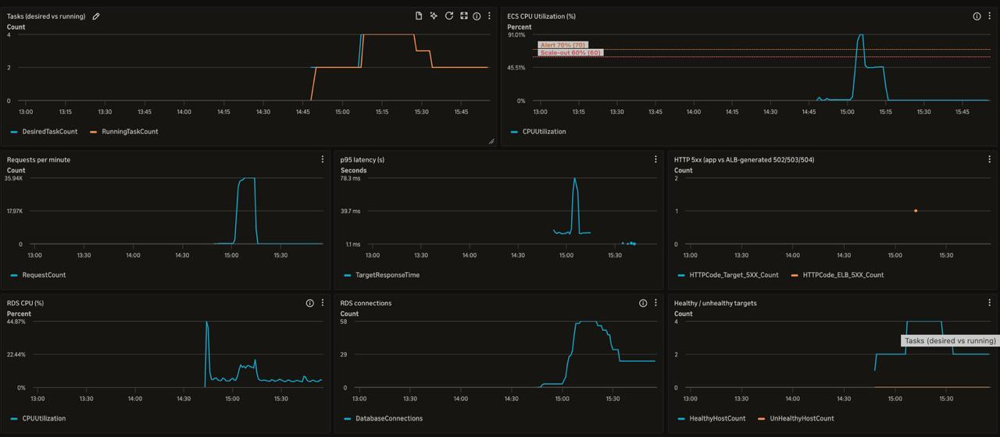

# Навантажувальне тестування (Locust)

## Сценарій користувача

Файл: [loadtest/locustfile.py](../loadtest/locustfile.py). Один цикл `ReadHeavyUser` = **1 запис + 8 читань** (без `/health`), далі пауза 2.5–3.5 с:

1. `POST /items` з унікальним `Idempotency-Key` → у режимі `async` `202` + `job_id`.
2. 3 × `GET /items` — список постів (з першої відповіді беруться id для подальших читань).
3. `GET /jobs/{job_id}` — статус власного запису; опитується до `done` (до 5 разів по 0.2 с), звідти береться `item_id` щойно створеного поста.
4. 4 × `GET /items/{id}` — 2 рази **щойно створений** пост і 2 випадкові пости зі списку.

«Даних автора» в моделі немає (у `Item` лише `name`/`description`), тому замість цього читання використовується статус задачі `GET /jobs/{job_id}`.

Опційно `RETRY_SHARE=0.2` додає повтор `POST` з тим самим ключем (демо завдання 7). За замовчуванням вимкнено, щоб у циклі був рівно один запис.

## Фази навантаження

Задаються класом `StagesShape` (Locust `LoadTestShape`), тест зупиняється сам:

| Фаза | Тривалість | Користувачі |
|---|---|---|
| Наростання | 150 с (2.5 хв) | 0 → N, ≈1.33 користувача/с |
| Стале навантаження | 300 с (5 хв) | N |
| Спад | 120 с (2 хв) | N → 0, ≈1.67 користувача/с |

## Команда запуску

```bash
cd lab1
./loadtest/run.sh
```

Скрипт бере `app_url` з `terraform output` (або з `URL=...`) і запускає:

```bash
locust -f loadtest/locustfile.py --headless --host "$URL" \
  --csv loadtest/results/run --html loadtest/results/report.html
```

## Параметри

| Параметр | Значення | Навіщо |
|---|---|---|
| `LOAD_USERS` (N) | 200 | ≈ 9 запитів за ~3.5 с на користувача → ~500 RPS. Цього досить, щоб CPU двох задач по 0.5 vCPU перевищив 60 % (scale-out) і 70 % (алерт) |
| `RAMP_UP_S` / `STEADY_S` / `RAMP_DOWN_S` | 150 / 300 / 120 | фази з умови завдання |
| `wait_time` | `between(2.5, 3.5)` | пауза «реального клієнта» між циклами |
| `--host` | ALB `app_url` | тест іде через ALB, як і реальний трафік |

Для швидкої локальної перевірки: `LOAD_USERS=10 RAMP_UP_S=10 STEADY_S=15 RAMP_DOWN_S=8 locust -f loadtest/locustfile.py --headless --host http://localhost:8000`.

## Прогон



## Підсумковий звіт

> ⚠️ Цифри нижче — з прогону **попередньої версії сценарію** (200 користувачів, без фаз спаду, кеш вимкнено; ті самі дані, що в колонці «без кешу» в [CACHE.md](CACHE.md)). Після прогону `./loadtest/run.sh` замінити їх рядком `Aggregated` з `loadtest/results/run_stats.csv`.

### Загалом

| Метрика | Значення |
|---|---|
| Усього запитів | **276241** |
| Помилок | **1** (**0.00024** %) |
| Середній RPS | **~486** |
| p50 | **68** мс |
| p95 | **240** мс |
| p99 | **350** мс |


### Висновки

- Кількість задач зросла з 2 до 4 через **~7 хв від старту тесту**: ~2 хв наростання, далі CPU перетнув 60 % і ще ≈3 хв минуло до нових задач (розбір затримок — в [AUTOSCALING.md](AUTOSCALING.md)).
- Помилки: **1** (`502` від ALB) — найімовірніше, запит потрапив на задачу в момент її реєстрації/зняття з target group.

