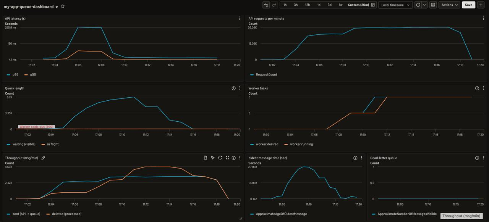

# Асинхронна обробка через чергу

## Принцип роботи
```
  Client ──POST /items──►  API  ──SendMessage──►  SQS  ──►  Worker  ──INSERT──►  PostgreSQL
         ◄─202 + job_id──   │                                 │
         ──GET /jobs/id─►   │ SET/GET status                  │ UPDATE status
         ◄──status───────   ▼                                 │
                          Redis ◄─────────────────────────────┘
```

1. Клієнт шле `POST /items` → API кладе задачу в SQS, пише `status=queued` у Redis і одразу відповідає `202 + job_id`.
2. Воркер забирає повідомлення з SQS, пише запис у PostgreSQL і оновлює статус у Redis.
3. Клієнт опитує `GET /jobs/<id>` → API читає статус із Redis.
- **API** кладе повідомлення в SQS, створює запис статусу в Redis і одразу відповідає.
- **Воркер** читає чергу, записує однією транзакцією, після чого видаляє з черги. Невдале повідомлення повертається в чергу, після 5 невдалих спроб (`queue_max_receive_count`) -> в DLQ
- **Статус задачі** зберігається в Redis, тому латентність POST не залежить від стану Postgres.

## Що змінилося для клієнта

| | Було (`WRITE_MODE=sync`) | Стало (`WRITE_MODE=async`) |
|---|---|---|
| `POST /items` | `200 OK` + створений `{id, name, description}` | `202 Accepted` + `{job_id, status:"queued", status_url}` і заголовок `Location: /jobs/<job_id>` |
| Коли запис є в БД | до відповіді | **через якийсь час після** відповіді (зазвичай мілісекунди–секунди; при великій черзі — довше) |
| Результат | у відповіді | потрібно запитати `GET /jobs/<job_id>` |
| Збій | `5xx` | `503` лише якщо не вдалося прийняти (Redis/SQS недоступні). Збій обробки видно в статусі задачі |

Клієнт більше не може вважати, що після відповіді `GET /items/{id}` одразу знайде запис.

## Як клієнт дізнається результат

Polling: `GET /jobs/{job_id}`.


| status | Значення |
|---|---|
| `queued` | у черзі, воркер ще не взяв |
| `processing` | воркер обробляє |
| `retrying` | остання спроба впала, повідомлення повернеться в чергу |
| `done` | готово; `item_id` і `result_url` вказують на створений запис |
| `failed` | вичерпано `MAX_RECEIVE_COUNT` спроб; повідомлення лежить у DLQ |


## Доставка «щонайменше один раз» 

SQS Standard гарантує, що повідомлення **буде доставлене принаймні раз**, але **не гарантує рівно раз** і не гарантує порядок. Повідомлення видаляється з черги лише після того, як воркер явно викличе `DeleteMessage` — після успішної обробки. Тому одне повідомлення може прийти воркеру кілька разів, коли:

1. воркер зробив роботу, але впав (або втратив мережу) **до** `DeleteMessage`;
2. обробка тривала довше за `visibility_timeout` (60 с), і SQS віддав повідомлення іншому воркеру;
3. рідкісні внутрішні дублі самого SQS Standard.

Це свідома ціна за надійність: краще обробити двічі, ніж загубити.

## Що буде при повторній обробці повідомлення

У цьому випадку повторна обробка **безпечна**, бо операція ідемпотентна на рівні БД:

- кожне повідомлення має `job_id`; у таблиці `items` колонка `job_id` має **UNIQUE**-індекс;
- воркер виконує `INSERT ... ON CONFLICT (job_id) DO NOTHING`. Другий раз рядок не створюється, воркер читає вже існуючий `item_id` і ставить `done`;
- статус `done` виставляється повторно з тим самим `item_id`, після чого повідомлення видаляється.

Якщо обробка раз за разом падає, після `maxReceiveCount = 5` отримань (`queue_max_receive_count` у `variables.tf`) SQS сам переносить повідомлення в **DLQ** (зберігається 14 днів), спрацьовує алярм `dlq-not-empty`, а в статусі задачі стоїть `failed`.


## Прогін




| Графік | Що відбувається |
|---|---|
| API requests/min | наростання 17:03–17:09 до ~36K/хв, плато до 17:17, спад |
| API latency | p95 короткочасно росте до ~256 мс (17:05–17:08). Після scale-out API p95 повертається до кількох мс і **лишається плоским, хоча черга росте до 6.7K** |
| Довжина черги | росте з 17:05, пік ~6.7K о 17:11, спорожніла до ~17:16 |
| Worker tasks | 1 → 3 (~17:08–17:09) → 5 (~17:11–17:12), тобто масштабування від довжини черги |
| Throughput | спочатку `deleted` < `sent` (черга накопичується), після scale-out воркерів `deleted` > `sent` (черга розбирається) |
| Вік найстарішого повідомлення | до ~2.7 хв: стільки клієнт у найгіршому разі чекав `status=done` |
| DLQ | 0 |

Тобто черга забрала на себе пікове навантаження запису: клієнт чекав результат довше (до 2.7 хв), але час відповіді `POST` від цього не залежав.

**Чому латентність не росте:** `POST` = одна швидка операція `SendMessage` + `SET` у Redis, без запису в Postgres.

### **Масштабування воркера**:

| Умова | Дія |
|---|---|
| черга ≥ 100 (1 хв) | +1 воркер; ≥ 300 → +2 |
| черга < 10 протягом 5 хв | −1 воркер |
| межі | `worker_min_capacity = 1`, `worker_max_capacity = 5` |

Затримки реакції: SQS публікує метрики раз на хвилину, алярм — 1 період, старт Fargate-задачі ~30–60 с; тому «пік» черги видно ще ~2 хв до появи нових воркерів.

Щоб черга взагалі накопичувалась, воркер імітує тривалу операцію (`WORKER_SIMULATED_WORK_MS`, у Terraform за замовчуванням 200 мс при `WORKER_CONCURRENCY = 4`). Без імітації запис у БД займає кілька мс і один воркер встигає за будь-яким тестовим навантаженням.